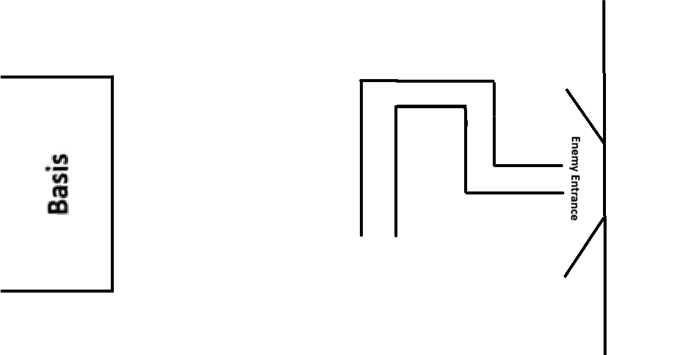

# TowerDefenseShenanigens
## afgekort TDS

## Spull voor de game

dit is de basic layout voor de map van het spel. De enemies komen van een punt van de map en lopen naar de main basis waarbij ze damage doen. Ik weet niet zeker of ik de basis echt ga houden, maar dat zie ik wel.

## Prog opdrachten

Hallo, dit is voor de opdracht van Erwin! Ik link hierzo de scripts waarin ik public variables heb gevonden en daarbij kan er gekeken worden wat er veranderd is, ik zal de oude code er ook bij zetten en nog wat screenshots van wat er verandert is.

[WaveManager](Assets/Scripts/WaveManager.cs)
In totaal bij deze heb ik 5 public variables, 3 ints, een float en een bool. 

[Projectile](Assets/Scripts/Projectile.cs)
In totaal 1 public variable, 1 float.

[Tower](Assets/Scripts/Tower.cs)
In totaal 4 public variables, 3 floats en 1 int.

[Eenmy](Assets/Scripts/Enemy.cs)
In totaal 3 public variables, 1 float en 2 ints.